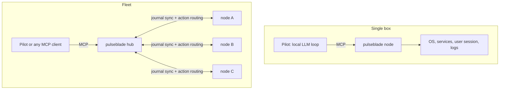
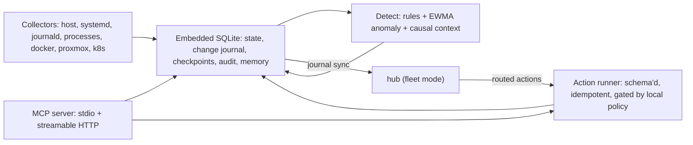

# Architecture

## Roles

Pulseblade separates three roles that "agent" would otherwise blur:

| Role | What it is | Command |
|------|------------|---------|
| **Node** | Per-host daemon: collectors, local store and change journal, action runner, MCP server, HTTP view (dashboard, JSON API, Prometheus) | `pulseblade node` (stdio: `pulseblade mcp`) |
| **Hub** | Control node: consumes every node's journal into fleet state and serves the same MCP tools fleet-wide | `pulseblade hub` |
| **Pilot** | Optional reasoning loop: an MCP client driven by any OpenAI-compatible model endpoint, local or remote, that investigates findings and proposes actions (M4) | `pulseblade pilot` |

`pulseblade ctl` gives shell access to the same queries (`status`, snapshot, checkpoint, changes, export, findings, `approve`).

The pilot is optional and replaceable: Cursor, HolmesGPT, agent runtimes such as Hermes Agent, or a custom script can use the same tools. The monitor never embeds a model, and nothing in the basic view needs one.

## Topologies



### Invariants

1. **One MCP contract at every tier.** A pilot written against a single node works unchanged against a hub. Resource ids already carry the hostname (`unit:<host>:<unit>`); the hub only adds fleet-level tools on top (`fleet_overview`).
2. **Nodes own their policy.** The hub may plan and route an action, but the node evaluates it against its own risk tiers and allow-lists before running it. A compromised hub or confused pilot can never exceed what each node permits. Approval can happen at either tier.
3. **Journals are the replication protocol.** Each node's change journal is append-only with monotonic `seq`. The hub keeps a per-node cursor and consumes changes after it; a disconnected node keeps journaling locally and the hub catches up on reconnect.
4. **Nodes need no inbound ports.** Nodes connect out to the hub to push journal entries and samples and to long-poll for routed actions.
5. **Pilots are event-driven.** On a single box the LLM competes for the CPU, GPU, and memory it observes, so the pilot wakes on a new or changed finding and on a health failure, not on a timer or every collection pass.

### Scaling the context window

A fleet of 100 nodes with ~150 resources each is ~15,000 resources. The hub's `fleet_overview` groups by semantic labels (`role`, `cluster`, `criticality`) and host, reports unhealthy items in full, and summarizes the rest as counts. Labels are therefore load-bearing in fleet mode, not decoration.

A hub can present itself as a node to a higher hub, so hub-of-hubs needs no new protocol when it is eventually needed.

## Node internals



## Crates

| Crate | Responsibility |
|-------|----------------|
| `pulseblade-core` | Schema types (`Resource`, `Sample`, `Change`, `Checkpoint`, `Finding`, `ActionSpec`, `ActionRun`, `Note`), label matching, duration parsing. Every type derives `JsonSchema`. |
| `pulseblade-store` | SQLite (`rusqlite`, bundled, WAL) on a node, Postgres on a hub that sets `database_url_env`. Resource state, append-only change journal, checkpoints, samples with retention, 5-minute buckets, and query-time downsampling, logs, notes, findings, action runs, and the hash-chained audit log. |
| `pulseblade-collect` | `Collector` trait plus host (`sysinfo`), systemd, user systemd and session, journald, and top processes. Docker (`bollard`), Proxmox (REST), and Kubernetes (`kube`) are Cargo features and degrade when the daemon or API is absent. |
| `pulseblade-detect` | Threshold rules and EWMA anomaly detection. Findings carry recent changes and error lines for the resource, its parent, and its dependencies. |
| `pulseblade-act` | Built-in action registry, node-local risk tiers, dry-run plans, approval gate, hash-chained audit. The node enforces its own policy. |
| `pulseblade-mcp` | Shared query layer (`query.rs`), the `rmcp` tool surface over stdio and streamable HTTP, and the node's HTTP surface: JSON API, Prometheus exposition, embedded dashboard. |
| `pulseblade-pilot` | Event-driven reasoning loop over MCP using an OpenAI-compatible model endpoint. |
| `pulseblade` | CLI binary, node loop, hub, config loading. |

## Data model

- **Resource** — anything observable. Ids are stable and hierarchical by convention: `host:<hostname>`, `disk:<hostname>:<mount>`, `net:<hostname>:<iface>`, `unit:<hostname>:<unit>`, `unit:<hostname>:user:<unit>`, `proc:<hostname>:<pid>`, `session:<hostname>`, `ctr:<host>:<name>`, `img:<host>:<name>`, `node:<name>`, `vm:<node>:<vmid>`, `lxc:<node>:<vmid>`, `storage:<node>:<name>`, `knode:<cluster>:<name>`, `workload:<cluster>:<ns>:<kind>:<name>`, `pod:<cluster>:<ns>:<name>`, `prom:<host>:<job>`. Each carries `kind`, `labels` (semantic, from collectors and config), `attrs` (slow-moving state facts that are change-tracked), and an optional `parent`. Guests and storage are parented to their Proxmox node; containers, images, and Prometheus jobs are parented to the host; pods are parented to their Kubernetes node.
- **Health** — pod and process health use the current sample, not a rate. The node collector scores them. Failed or Unknown pod phase is failed. Pending is degraded. A Running or Succeeded pod is degraded when its newest container restart is inside `pod_restart_window_mins` (default 15) or the lifetime restart sum is at least `pod_restart_lifetime` (default 100). A container with `restartCount > 0` contributes `state.running.startedAt`; a container waiting in backoff contributes `lastState.terminated.finishedAt`; the newest of those is stored as `restarted_at` and `k8s.restarts` stays the lifetime sum. A process is degraded at `proc_mem_degraded` (default 25% of RAM) and failed at `proc_mem_failed` (default 50%), or failed when CPU is at least `proc_cpu_share_failed` (default 90% of the host, `proc.cpu_pct / cpu_count`, where 100 is the whole machine). From 50% of the host up to that line the dashboard shows busy and stored health stays ok. `proc.cpu_pct` stays the one-core sample and is not a default anomaly metric. The process collector records threads, including KVM vCPU threads, as separate processes that share the parent RSS. The same numbers are `[health]` in toml and the portal document on `/hub/v1/poll`.
- **Sample** — `(resource, metric, ts, value)`. Fast-moving numbers live here, not in `attrs`, so they never generate change noise.
- **Change** — append-only journal entry with a monotonically increasing `seq`: `appeared`, `disappeared`, or `changed` with `before`/`after`.
- **Checkpoint** — a name bound to a `seq`. `changes_since` accepts a checkpoint name, `seq:<n>`, an RFC 3339 timestamp, or a relative duration like `15m`.
- **Finding** — an open, acked, or resolved condition. Context is the recent changes and error lines on the resource, its parent, and its dependencies. Listings omit that context unless the caller asks.
- **Note** — short text attached to a resource, returned by `resource_explain` and `memory_search`.
- **Action run** — a planned or executed remediation. `auto` runs on execute, `approve` waits for a human, `deny` never runs. Each transition appends to the audit log, whose hash chains to the previous row.

Collectors report the full set of resources they own on each pass. The store diffs that set against the previous one to produce changes, so disappearance is detected without collector-side bookkeeping.

## Concurrency

Only one process collects per database. Collection takes an exclusive lock on `<db>.lock`; `pulseblade mcp` collects only if the lock is free, otherwise it serves the database a running node maintains. `pulseblade node --no-collect` never takes the lock and only serves an existing database (offline inspection, demo data). Detection runs on the collector thread after each pass, so a read-only MCP process does not open findings of its own. SQLite runs in WAL mode so readers never block the collector.

## Self-observability

Every collector pass is recorded in a `collector_runs` table (source, time, duration, ok/error, resource, sample, and change counts, configured interval; the last 240 runs per source are kept). Because it lives in the store, any process reading the database (the node, `pulseblade mcp`, `pulseblade ctl`) can judge collector health. A collector is **stale** after three intervals (at least 60 s) without a pass. Health surfaces in four places: the `collectors` block of `state_snapshot`, `/api/v1/status`, `pulseblade_collector_*` Prometheus series, and `ctl status`.

## HTTP surface

`pulseblade node` serves one axum router on its listen address (loopback by default). `pulseblade mcp` serves the same router alongside stdio when the dashboard is enabled (`--dashboard`, `--listen`, or `dashboard = true`); a busy listen address is logged and stdio keeps running.

- `/mcp` — MCP streamable HTTP.
- `/api/v1/*` — JSON API: `status`, `snapshot`, `resources/{id}`, `metrics`, `history`, `search`, `changes`, `checkpoints`, `findings`, `logs`, `actions`. `POST /api/v1/actions/{id}/approve` is the approval webhook (optional `Authorization: Bearer` when `actions.approve_token` is set). Handlers call the same functions as the MCP tools; errors are `{error}` with 400 or 404. The host allow-list wraps this route too.
- `/metrics` — Prometheus text exposition 0.0.4. Resource health is encoded 0 ok, 1 unknown, 2 degraded, 3 failed.
- `/` — a single self-contained HTML page (`include_str!`, vanilla JS, no CDN or build step) that polls the JSON API.

The page layout is in [DASHBOARD.md](DASHBOARD.md).

A Host-header allow-list (loopback, the listen address, and `allowed_hosts`) guards every route against DNS rebinding. There is no built-in authentication; remote access goes through a reverse proxy that adds TLS and auth.

## Response design for agents

- Every response includes `as_of_seq`, so an agent can use it directly as the next `changes_since` cursor.
- Lists are bounded (`limit`), ordered by relevance (unhealthy first), and report `truncated` with totals.
- Time series are capped at 300 points; the step widens automatically when needed.

## Token efficiency

Tokens are the agent's scarcest resource, so defaults are small and detail is opt-in:

1. **Summary first.** `state_snapshot` without filters returns counts by kind, collector health, host key metrics, and only unhealthy resources (with attributes). `detail=brief` lists every matching resource; `detail=full` adds all labels and attributes. Filters default to `brief`.
2. **Cursors, not re-reads.** Every response carries `as_of_seq`. `changes_since seq:<n>` returns only the delta, and `state_snapshot if_changed_since=<n>` returns `{as_of_seq, unchanged: true}` (about 8 tokens) when the journal has not moved. Failing or stale collectors still appear in that response.
3. **No redundancy.** Summary and brief entries drop the `host` label and a `name` that repeats the id (`unit:web1:sshd.service`); full detail, `resource_explain`, and export keep them. Zero failure counts are omitted.
4. **Compact encodings.** `metrics_query` returns `start`, `step_secs`, and a `values` array (null for empty buckets) instead of timestamped objects, targeting ~120 points by default with the step no finer than the collection interval. `changes_since` omits per-change `ts` by default and reports `first_ts`/`last_ts` for the set (`compact: false` restores it).
5. **Drill down only on change.** `resource_explain` and `metrics_query` are for the few resources that changed or are unhealthy; `export_bulk` is for offline analysis.

Measured with `cargo test -p pulseblade-mcp --test token_budget -- --nocapture` (approximate tokens as JSON characters / 4) against a realistic host: 1 host, 10 disks, 7 interfaces, 130 services (one failed), an hour of 15 s samples, ~610 journal entries:

| Response | Before | After |
|----------|-------:|------:|
| `state_snapshot` default | 2,037 | 154 (summary) |
| `state_snapshot` brief (previous default behavior) | 2,037 | 1,380 |
| `state_snapshot` full (was `verbose`) | 3,499 | 3,507 |
| `state_snapshot kind=service limit=500` | 4,558 | 2,598 |
| `state_snapshot if_changed_since` (unchanged) | — | 8 |
| `metrics_query` 1 h default | 2,649 | 207 |
| `changes_since` 100 changes | 4,632 | 3,851 (compact) / 4,651 (`compact: false`) |
| `resource_explain` service / host | 396 / 369 | 396 / 353 |
| `export_bulk` resources | 16,379 | 16,379 |

The test fails if the summary snapshot exceeds 600 tokens, the unchanged response 20, or the default 1 h series 600.

## Hub

`pulseblade hub` keeps the fleet journal in Postgres when `database_url_env` names a variable that holds the URL. `database_user_env`, `database_password_env`, and `database_ca_env` are environment variable names too; none of the four is a secret value. An empty `database_url_env` keeps the hub on one SQLite file, which is also what every node uses. Unknown config fields are rejected. New `[hub]` fields have defaults, and `pulseblade node` ignores `[hub]`. Accepting a push upserts `node_cursors.last_push_ms` before the batch transaction, then inserts changes, resources, samples, 5-minute buckets, and events in multi-row chunks of 80. `latest` and `sample_buckets` are sorted before write, and a deadlock is retried once. Placeholders stay `?` / `?1` and are rewritten to `$n` on Postgres. Optional filters use `CAST(?1 AS TEXT)`. Event inserts are `ON CONFLICT DO NOTHING`. The Postgres client is opened and dropped off the tokio runtime. Each enrolled node has a bearer token (`token_env` names the variable; the token is not written in config). An `https://` upstream is normal TLS plus that bearer token. mTLS applies only when the node sets client `cert` and `key`; the hub then requires a client certificate signed by `client_ca`. Nodes open the connection: they push journal entries and samples after the hub's per-node cursor, then long-poll `/hub/v1/poll` for routed actions (`plan`, `execute`, `status`) and the current `[health]` document. A node that was offline keeps journaling locally and sends every seq after the cursor when it reconnects; a gap is rejected and the cursor stays put.

The hub serves the same MCP tools as a node, plus `fleet_overview` (grouped by `role`, `cluster`, `criticality`, and host; unhealthy resources in full, the rest as counts). `action_plan`, `action_execute`, and `action_status` are forwarded with `route_node`, which uses the second segment of `resource_id` as the enrolled node name. For `unit:<node>:…` that segment is the node. For `workload:<cluster>:…` and `pod:<cluster>:…` it is the cluster name. The node runs them through its own registry. `action_plan` does not execute. Auto runs immediately, approve waits, and deny is rejected, according to that node's own tier.

A node that stops pushing leaves its resources as last reported. The hub does not mark them disappeared. `sync_offline_hosts` runs on the 15s maintain loop, not inside the push handler. After three missed pushes (the interval defaults to 15s; hub nodes do not use the collector's 60s floor) the node is stale on `/api/v1/status` and the snapshot, the fleet tile shows the host stale, and one `host offline` finding stays open, with last health, recent changes, and error lines already stored for that host. The next push resolves it. On SIGTERM the node sends one last push with `shutting_down` when an upstream hub is configured; a crash does not, so it shows up as silence.

Raw samples are kept 24 hours on the hub. A node's own `retention_hours` (default 24) still bounds its local raw window. Each sample also updates a 5-minute min/max/avg bucket, and those buckets plus failures, restarts, and error lines are kept 90 days (`history_days`). Changes and absent resources are kept 30 days (`change_retention_days`). Prune is an hourly `DELETE` and does not `VACUUM`. Sample counts use a counter row. The node rolls closed buckets before it pushes them. `history` returns a short downsampled series, from raw samples when they still cover `since`, otherwise from the 5-minute buckets. `search` returns resource id, time, severity, a short excerpt, and a cursor. SQLite search is FTS; Postgres search is `ILIKE`. Info logs are not shipped.

Packaging: [deploy/Dockerfile](../deploy/Dockerfile), [deploy/pulseblade-hub.service](../deploy/pulseblade-hub.service), [deploy/pulseblade-node.service](../deploy/pulseblade-node.service).

## Pilot

The pilot ([#6](https://github.com/DataKnifeAI/pulseblade/issues/6)) is an optional MCP client with a model behind it. `pulseblade pilot` polls a node or a hub at `mcp_url` (default `http://<listen>/mcp`). The same binary targets either; only the URL changes.

### One provider interface

The pilot speaks a single protocol: **OpenAI-compatible Chat Completions with tool calling**. An endpoint is configured by `base_url`, `model`, `api_key_env` (the *name* of an environment variable holding the key; keys never live in config), and optional extra `headers`. That one interface covers local and remote backends; upstream products appear here only as integration examples, never in Pulseblade type or config names (the provider kind is `openai_compatible`).

| Example backend | `base_url` | Key |
|-----------------|-----------|-----|
| Ollama | `http://localhost:11434/v1` | none |
| vLLM | `http://<host>:8000/v1` | optional |
| OpenRouter | `https://openrouter.ai/api/v1` | `OPENROUTER_API_KEY` |
| Hermes models (served via vLLM or Ollama) | as above | as above |

External agent runtimes such as Hermes Agent do not need the pilot at all: they can consume Pulseblade directly as an MCP server (stdio or `/mcp`).

### Tiered routing

- **Triage** on a cheap local model: is this finding noise, known, or worth investigating?
- **Escalation** (optional) to a stronger, possibly remote model when triage says so or the triage budget runs out.
- **Fallback**: each tier is an ordered list of endpoints; if one is down or errors, the next is tried.
- **Local-only mode** for air-gapped hosts: remote endpoints are refused even if configured.

### Token strategy

- **Zero LLM calls at steady state.** The pilot wakes on a new or changed finding, or when health became failed or degraded. The same finding and the same failure are not sent again. A routine journal line and the poll timer do not call the model.
- **Deterministic pre-digestion in Rust.** Findings already carry causal context (recent changes on the resource, its parent, and its dependencies), so the first prompt is small and specific.
- **Start from summaries and cursors.** Summary snapshot, `changes_since` from the last seen `as_of_seq`, `if_changed_since` on re-checks.
- **Cap tool outputs** (limits, `detail=brief` at most, short `metrics_query` ranges) and truncate anything that still exceeds a per-call ceiling.
- **Budgets per investigation:** max tool calls, tokens, and wall time; token usage reported by the endpoint is recorded per run.
- **Prompt-cache friendly:** a stable system prompt and tool definitions first, variable context last.
- **Memory over re-derivation:** prior investigation notes on a resource are loaded before re-investigating it.

### Example configuration

`execute_auto` defaults to false. Approve and deny tiers are never executed by the pilot; the node enforces them even if a model asks. `local_only` drops any `base_url` that is not loopback. Each tier is an ordered fallback list. A spent tool budget on a tier continues on the next tier when one exists; token and wall-clock budgets end the run. Quiet polls do not call the model. Each investigation is stored and listed with `pulseblade ctl runs`.

```toml
[pilot]
enabled = true
local_only = false
wake_on = ["findings", "changes"]
heartbeat_secs = 900
poll_secs = 30
execute_auto = false
mcp_url = ""

[pilot.budget]
max_tool_calls = 12
max_tokens = 20000
max_wall_secs = 120

[[pilot.tiers]]
name = "triage"
[[pilot.tiers.endpoints]]
kind = "openai_compatible"
base_url = "http://127.0.0.1:11434/v1"   # e.g. Ollama
model = "qwen3:8b"

[[pilot.tiers]]
name = "escalate"
[[pilot.tiers.endpoints]]
kind = "openai_compatible"
base_url = "http://127.0.0.1:8000/v1"    # e.g. vLLM serving a Hermes model
model = "example-70b"
[[pilot.tiers.endpoints]]                # fallback when the first endpoint errors
kind = "openai_compatible"
base_url = "https://models.example/v1"
model = "example-sonnet"
api_key_env = "EXAMPLE_API_KEY"
headers = { "X-Title" = "pulseblade" }
```
