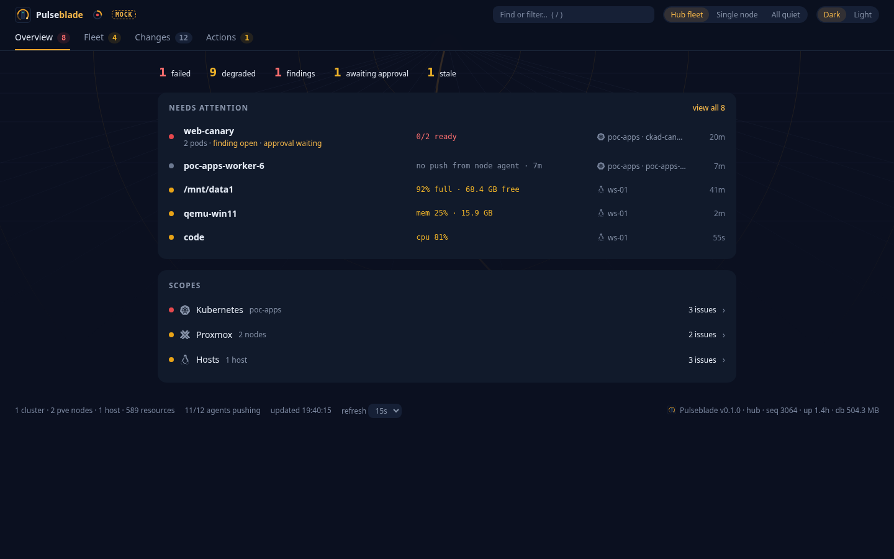
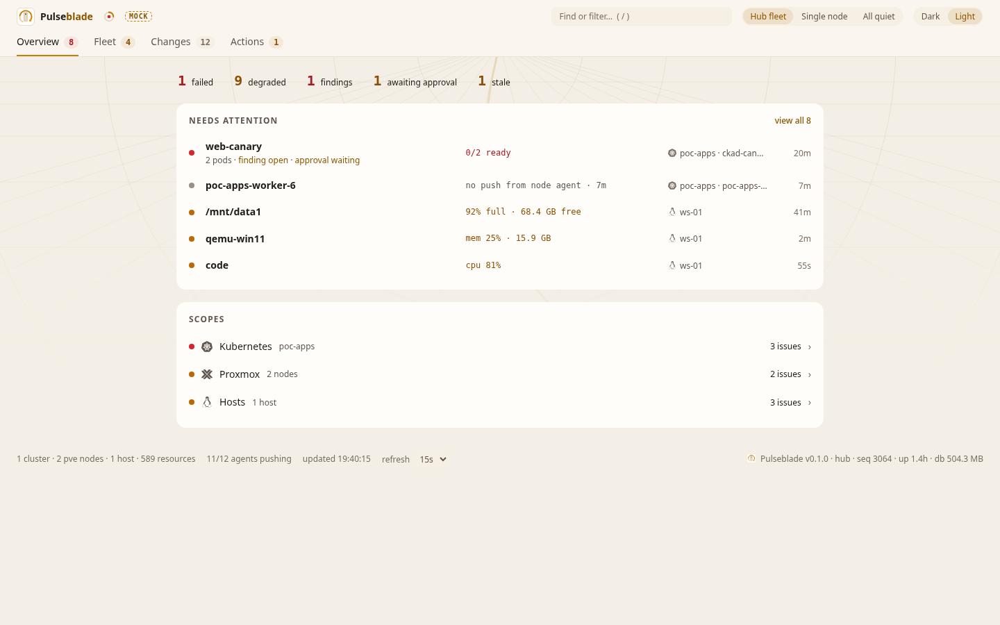
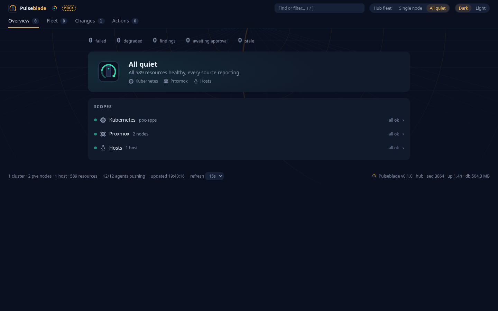
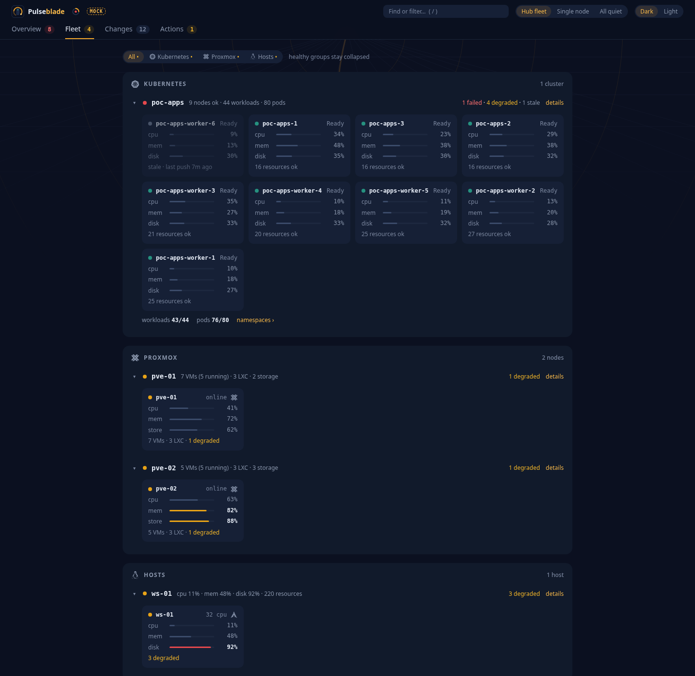
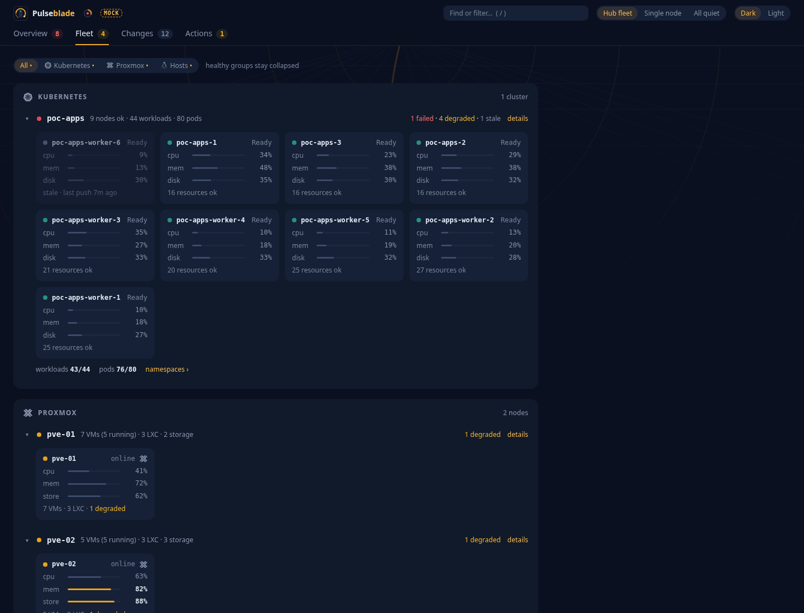
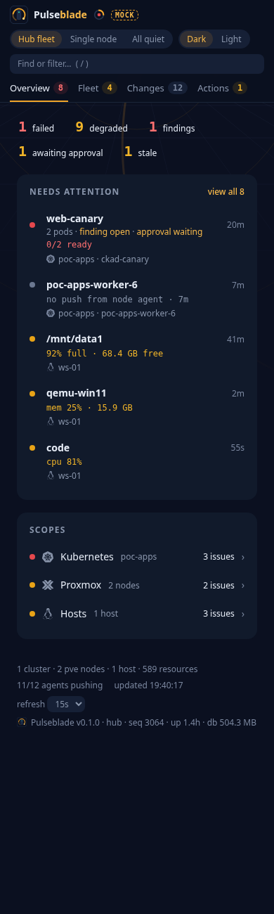
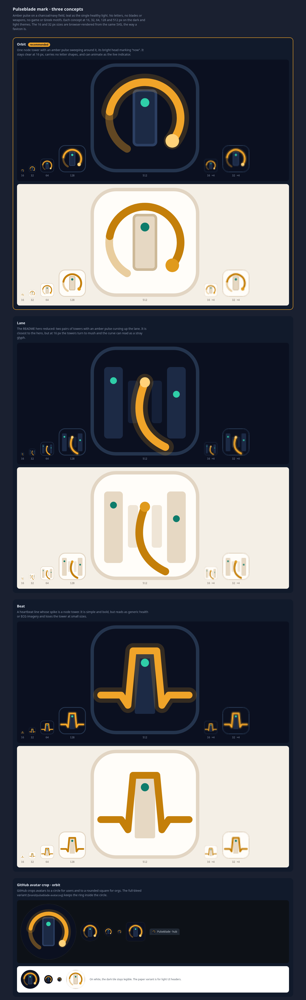

# Dashboard

The page at `/` serves this layout. It is the self-contained HTML in `crates/pulseblade-mcp/src/dashboard.html`: dark by default, light toggle kept in `localStorage` and applied before first paint. Detail opens in a side panel; the list stays put. The screenshots are the design reference (sample fleet `poc-apps`, `pve-01`, `ws-01`).

## Open at a glance

Four tabs: **Overview**, **Fleet**, **Changes**, **Actions**. Dark is the default. Detail opens in a side panel; the list stays put.

**Overview** is an attention strip (failed, degraded, findings, awaiting approval, stale), the top problems, and one line per scope. When nothing is wrong, the page is the strip at zero and those scope lines.

**Fleet** groups machines under Kubernetes, Proxmox, and Hosts. Healthy groups stay collapsed. Each machine is one tile.

Screenshots are a sample fleet (`poc-apps`, `pve-01`, `ws-01`).



*Overview, dark.*



*Overview, light.*



*All quiet.*



*Fleet. Healthy groups stay collapsed.*



*Detail.*



*Overview at 390px wide.*

## Avatar

Recommend **Orbit**: a node tower, a teal light, and an amber pulse arc whose bright head marks now.


Orbit is the one that still reads at 16px, has no letters, and is not a weapon. **Lane** is the hero reduced to two pairs of towers and a curve; at 16px the towers turn to mush and the curve can read as a stray glyph. **Beat** is a heartbeat whose spike is a tower; it reads as generic health imagery and loses the tower at small sizes.



*Orbit, Lane, and Beat.*

`pulseblade-mark.svg` is the square mark (`pulseblade-mark-light.svg` on a light header). `pulseblade-avatar.svg` is the full-bleed crop for a circle. `favicon-32.png` is the 32px favicon.

No text in the mark. No blades or weapons. No game imagery. No Greek motifs.

## System icons

Kubernetes, Proxmox, Linux and distro, and Docker marks in the page are [Simple Icons](https://simpleicons.org) paths (CC0), inlined, and name those integrated systems; generic line icons are original, and the trademarks stay with their owners.

## Data the dashboard still degrades without

Hub `/api/v1/status` includes `nodes` (`node`, `seq`, `last_push_age_secs`, `stale`, and `shutting_down` after a shutdown push) once a node has pushed, so a node that stops pushing is not shown as healthy. The field is omitted on a node.

Still missing, and the page works around each gap:

- A pod owner label. Pods group under a workload when `labels.owner` or the parent id matches; otherwise by name prefix, or they stand alone.
- A pod node label. A pod is not pinned to a machine tile unless its parent or id says which node.
- A host label on Proxmox nodes. A Proxmox node and a host tile merge when their names match.
- A kind or label that distinguishes a Proxmox node from a Kubernetes node. Kubernetes nodes are `knode:` ids. The Proxmox section appears only when `vm:`, `lxc:`, or `storage:` resources exist; `node:` ids in that fleet are Proxmox nodes.

## How the page fetches

It polls a summary snapshot, status, findings, and actions (not a full resource dump) and refreshes every 15 seconds (pausable). Clocks and timestamps use the portal timezone and time format. The zone default is `America/Los_Angeles` (Pacific: PDT or PST by date), from the `timezone` config key, unless this browser has saved another IANA zone. The format default is 12-hour (`time_format = "12h"`), unless this browser has saved 24-hour. Settings also edits the health cutoffs; a save writes the hub copy that nodes pick up on their next poll. Detail stays in the side panel, with at most one sparkline, fetched when that panel opens. Deep links: `/?tab=overview&kind=service&q=ssh&select=unit:web1:sshd.service&metric=cpu.used_pct&theme=dark`.

Sample fleet in the screenshots, not a live machine.

Seed two hours of deterministic demo data (written through the normal store API, ending now) and serve it within a minute, before the collectors read as stale:

```bash
cargo run -p pulseblade --example seed_demo -- /tmp/pb-demo/pb.db
cargo run -p pulseblade -- --db /tmp/pb-demo/pb.db node --no-collect --listen 127.0.0.1:7188
```

Open `http://127.0.0.1:7188/`.
